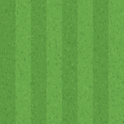
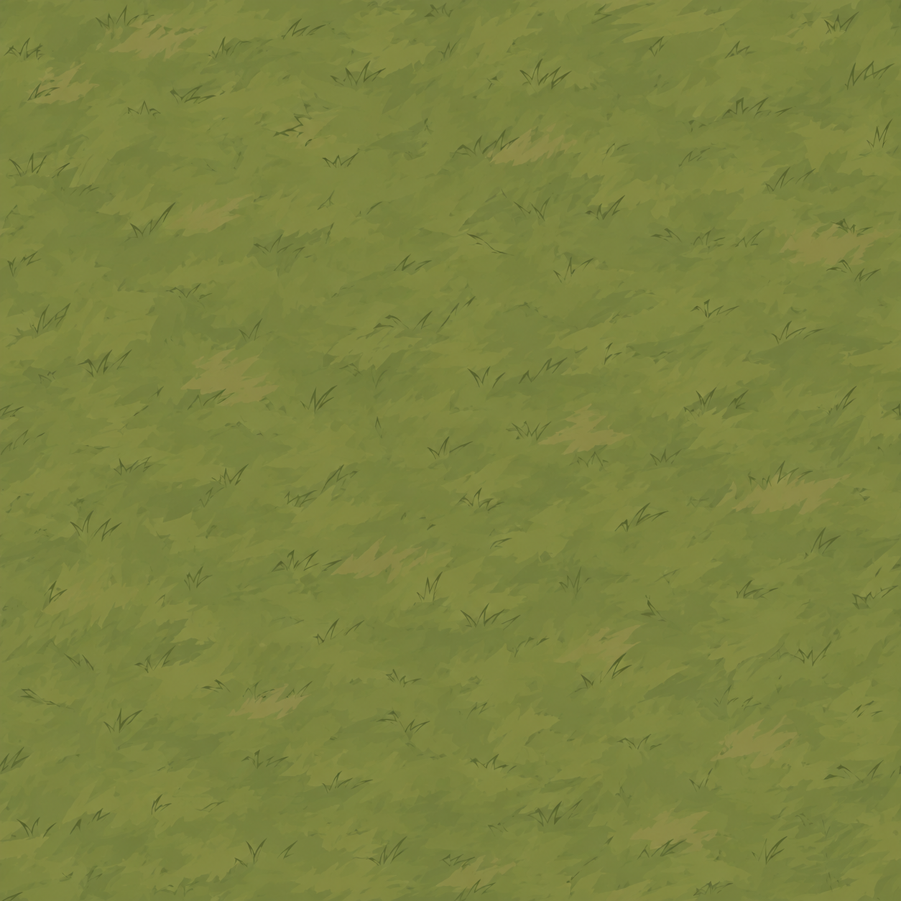
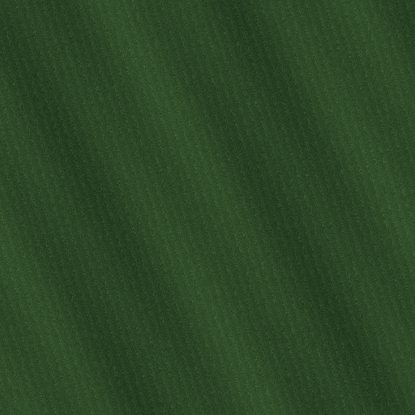

# Visual identity pass · 16 November 2026

## Implemented

- Rust Race Oval selects the original `lawn.png`; the Backyard keeps its newer `lawn_overhaul.png` material.
- Smoko has a new Blender-authored roadside cluster with worn tyres, a readable TYRES sign, parts crate, esky and braced timber rail. Its solid bounds were checked against spawns, scoring approaches, delivery lanes, existing solids and the road envelope.
- Teddy Heist uses its own close-cut turf and dry oval shoulder. Backyard scene objects, their colliders, pool physics and pool effects are disabled in Heist.
- Rust Heist defenders now target the real player position. Character belly motion and breathing are cosmetic.
- Browser prototype version: **0.23.19**. The browser game has the equivalent Heist turf and character motion; it has no Race Oval or Smoko map.

## Texture previews

These are the texture assets used by the builds, not in-game screenshots.

## Verification

- `cargo test --workspace`: **464 passed**.
- Browser inline JavaScript and `public/room-ws.js` syntax checks: **passed**.
- `git diff --check`: **passed**.
- Blender MCP generated and inspected the roadside cluster and Heist turf. The source Blender scene returned to 170 meshes after temporary imports and renders.
- The 150-second Rust Heist bot test verified movement and a completed steal and bank.
- The native screenshot command launched, but the locked Mac display returned a fully black image; I discarded that capture. The browser UI surface was unavailable in this session. Therefore matched in-game Race views, native character-motion review, and hands-on browser play still need a visual check on an unlocked Mac. Networking was not changed, so an online host/guest test was not needed.

The isolated Blender view of the roadside prop was shown in the conversation. Runtime model: [`smoko_roadside_cluster.glb`](../../rust/crates/bbq_app/assets/models/smoko_roadside_cluster.glb). Authoring script: [`make_visual_pass_assets.py`](../../rust/tools/make_visual_pass_assets.py).
